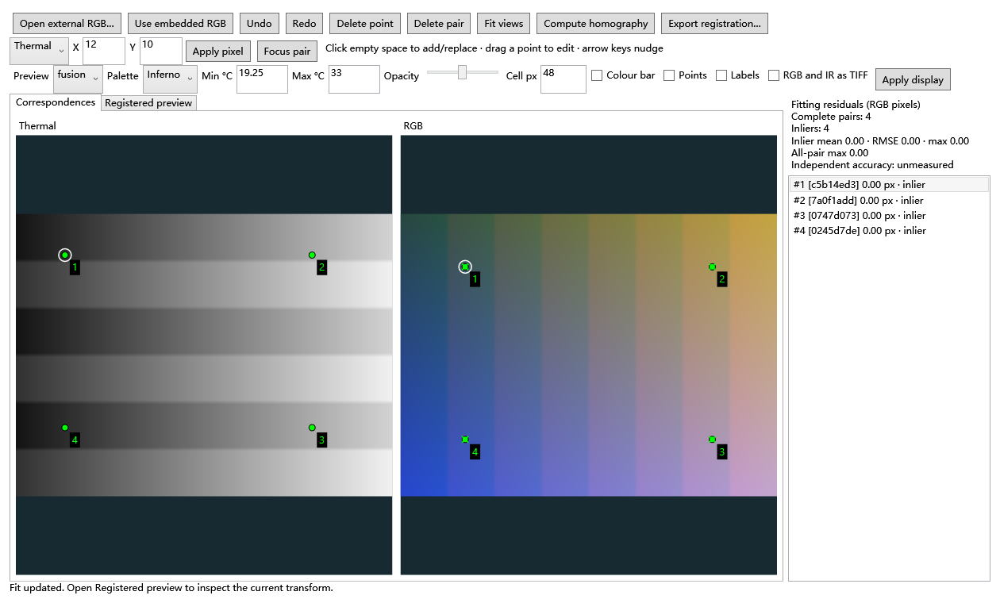
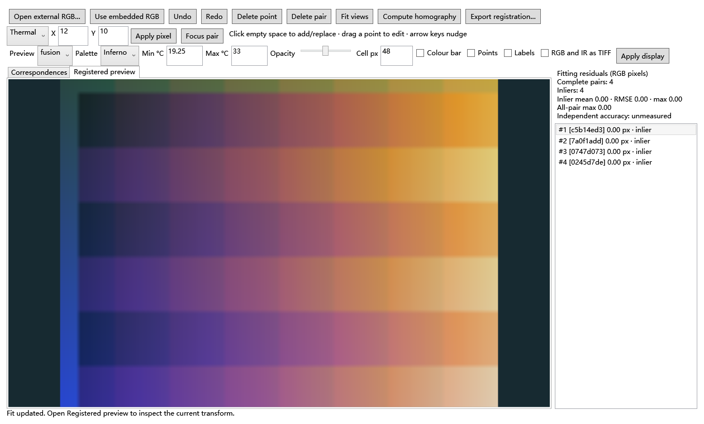
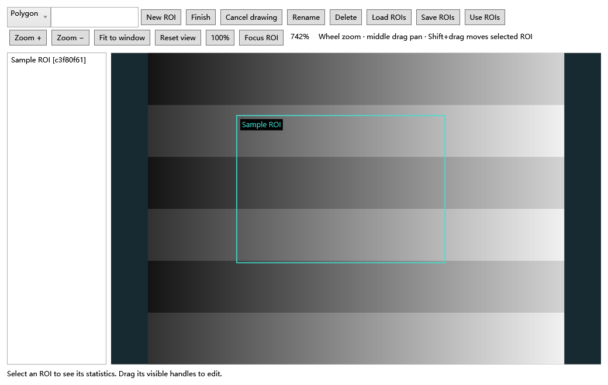
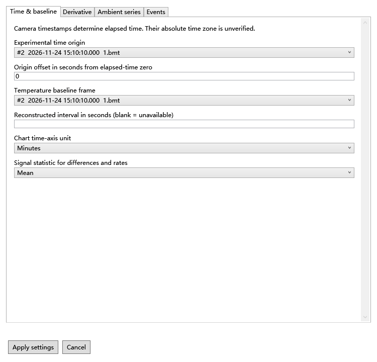
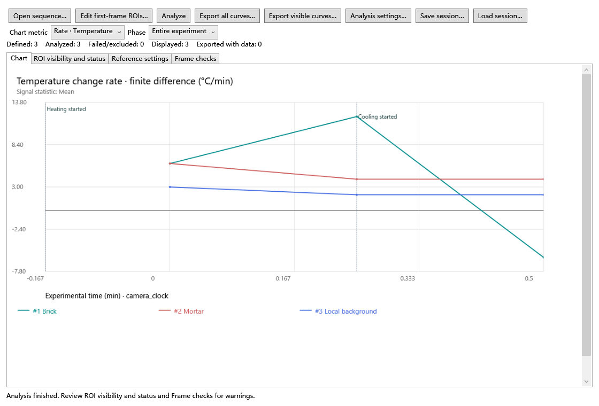

# BMT Thermal Analysis Studio v0.4.0

Windows x64 release focused on editable RGB–thermal registration and reproducible material-monitoring analysis.

- Edit thermal and RGB control points independently. Pair IDs survive movement, point replacement and undo/redo. The original thesis registration worker refreshes the fit after each completed edit.
- Export native-size fused, checkerboard and registered thermal views. The registered temperature export includes NPY, CSV, validity mask and transformation metadata.
- Zoom, pan, focus and move native ROIs. Monitor median temperature in addition to the existing statistics.
- Set an experimental time origin separately from the temperature baseline. Annotate events and inspect experimental phases.
- Compare materials against per-ROI backgrounds, external ambient air or other material ROIs. Export raw and optional regression-based rates, with independent axis and rate units.
- Export all eligible or visible chart curves. Both modes retain the entire ROI/frame collection in CSV. The session, analysis metadata and phase indicators accompany the export.

## Feature examples

The following screenshots use synthetic fixtures.

### Edit and inspect RGB–thermal correspondences

Select a point to highlight its counterpart. Move it with the mouse, arrow keys or integer coordinates, then inspect the recalculated fit residuals in RGB pixels.

### Preview and export image fusion

Adjust the thermal palette, temperature range and fusion opacity. The registration export also includes a checkerboard image, a validity mask and a separate radiometric temperature matrix.

### Edit ROIs at native thermal coordinates

Zoom and pan to work on small regions. Move a region with Shift-drag or resize it by dragging a vertex. Its saved geometry stays on the native thermal grid.

### Set the experimental clock and inspect temperature rates

`Reconstructed interval` is the time between frames when you explicitly reconstruct an incomplete camera clock. `Trailing regression window` is the look-back duration for the rate fit. For a verified 5-minute cadence, use a 300-second reconstructed interval if needed and a 600-second regression window to include three consecutive frames.

The chart shows warming and cooling relative to the zero-rate line. Event markers identify experimental phases, while the complete CSV retains every ROI and frame.

## Validation

ROI regression passed for 1, 5, 6, 10, 20, 50 and 101 ROIs. Two real 38-frame BMT sessions retained the original temperature statistics for all seven ROIs. The irregular-interval rate fixture reproduced +0.10, +0.20 and −0.10 °C/s.

See the [user guide](STUDIO.md) and [development report](REGISTRATION-THERMAL-ANALYSIS-UPDATE.md) for methods, reproducible tests and limitations.
